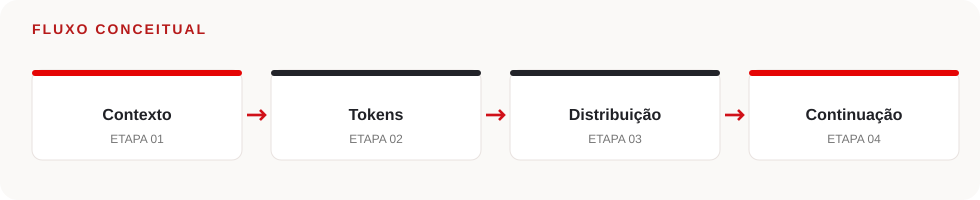

Aula 01 · Marketing analítico

# Como uma máquina produz linguagem?

120 minutos60 min de conceitos60 min de aplicaçãoCodex · 100% por prompts

<strong>Pergunta da aula:</strong> Por que um modelo treinado para prever tokens consegue examinar uma avaliação de consumidor?

## Abertura · 10 minutos

Apresente uma avaliação com elogio e ressalva negativa. Pergunte que informações podem ser afirmadas a partir do texto e quais seriam suposições. Essa distinção acompanhará toda a disciplina.

## 1. O problema de decisão

Uma empresa recebe centenas de avaliações sobre seus produtos. A diretoria quer distinguir reclamações de preço, defeitos e problemas de entrega, sem reduzir toda mensagem a uma nota. Um LLM parece compreender a experiência descrita, mas também pode ignorar uma ressalva ou completar lacunas com informações inexistentes. A primeira tarefa do analista não é automatizar a decisão: é observar o que o modelo produz e compreender de onde pode surgir uma resposta incorreta.

**Objetivo ao final do encontro:** saber explicar o mecanismo central, reconhecê-lo em exemplos pequenos e construir uma aplicação que permita observar seus limites.

## 2. Construção dos conceitos · 35 minutos

### 1. Tokenização

A entrada é transformada em unidades de processamento. Um token pode representar parte de uma palavra; o número de tokens não coincide necessariamente com o número de palavras.

### 2. Predição autorregressiva

O modelo estima uma distribuição para o próximo token, condicionado aos anteriores. Após escolher um token, repete o procedimento.

### 3. Atenção e contexto

A atenção permite combinar representações de posições diferentes. A janela de contexto limita a informação acessível na execução.

### 4. Limites de evidência

Uma resposta plausível pode não estar sustentada pela mensagem. O LLM não consulta automaticamente a base de dados da empresa.

### Erros de interpretação frequentes

Não confundir token com palavra; atenção com pesquisa na internet; fluência com verdade; temperatura com capacidade de verificar documentos.

## 3. Exemplo mínimo · 15 minutos

**Situação.** Para a continuação de “A entrega foi”, admita P(rápida)=0,60, P(lenta)=0,25 e P(cara)=0,15. Essas probabilidades somam 1. Se o contexto mudar para “Apesar de barata, a entrega foi”, a distribuição pode mudar. Isso não significa que o modelo verificou um fato; significa apenas que condicionou a previsão a um contexto diferente.

**Resolução e interpretação.** Se escolhermos sempre o token mais provável, nesta etapa a continuação será “rápida”. Se amostrarmos segundo a distribuição, “lenta” também pode aparecer. Precisão factual não equivale à probabilidade do próximo token.

**Para resolver em papel.** Compare a geração gulosa e a amostragem em uma tabela de três probabilidades e explique por que saídas diferentes não provam que uma está errada.

A resolução deve explicitar as premissas antes de calcular ou interpretar um resultado. O objetivo não é reproduzir a interface da aplicação, mas compreender a estrutura lógica que ela implementa.

## 4. Simulador interativo

Use os controles para modificar uma hipótese e observar a consequência. O simulador é intencionalmente reduzido.

<iframe class="sim-frame" src="../../assets/simuladores/01.html" title="Probabilidades de próximos tokens" loading="lazy"></iframe>

[Abrir o simulador em uma nova página](../../assets/simuladores/01.html) · [Apresentação da aula](slides/aula.html) · [Notebook da aula](aula.ipynb)

## 5. Laboratório com Codex · 50 minutos

**Aplicação:** Painel de avaliações de consumidores com identificação de atributos, elogios, críticas e trechos que fundamentam cada interpretação.

A construção será feita inteiramente por prompts. O aluno pode inspecionar o código e pedir explicações, mas não editar linhas manualmente. O professor fornece uma versão de referência quando houver dependência de uma aula anterior.

### Prompt inicial para o Codex

> Crie um painel local de análise de avaliações usando dados/marketing_reviews.csv. Mostre o texto, os atributos identificados, pontos positivos e negativos e a evidência literal correspondente. Permita comparar duas instruções. Use o backend determinístico de demonstração quando não houver acesso a modelo; se houver acesso, disponibilize uma rota API e uma rota Codex CLI/SDK para experimentação em lotes. Exiba sempre qual rota foi utilizada. Não produza decisões automáticas de Marketing.

### Três testes de aceitação

1. Avaliação positiva com ressalva negativa.
2. Avaliação sem indicação de preço.
3. Texto contraditório que exige justificativa.

## Duas rotas de execução

As duas alternativas são oferecidas no mesmo projeto. **Nenhuma exige escrever código manualmente.** A diferença está no modo de executar funcionalidades que dependem de um modelo.

=== "Rota A · API"

    1. Peça ao Codex para preparar a integração pelo SDK Python da OpenAI, com credencial em variável de ambiente e nunca no repositório.
    2. Solicite que ele execute testes com o conjunto local e, quando a API estiver autorizada, testes com modelo remoto.
    3. Compare as saídas e registre modelo, parâmetros, data e custos quando disponíveis.

=== "Rota B · Codex CLI / Python SDK"

    1. Autentique-se no Codex com a licença institucional disponível e abra a pasta do projeto.
    2. Solicite ao Codex, pela interface ou CLI, que execute a mesma tarefa em lotes sobre os arquivos locais, produzindo saídas estruturadas para conferência.
    3. Para automação supervisionada, o SDK Python `openai-codex` permite iniciar threads autenticadas no Codex e receber resultados. Essa alternativa **não equivale automaticamente a uma API de inferência em tempo real**. Use os resultados gerados em lote no laboratório local.

O laboratório inclui ainda uma demonstração determinística, que pode ser executada sem credenciais. [Detalhes técnicos e limites das rotas](../../programa/codex.md).

## 6. Verificação conceitual · 10 minutos

## 7. Atividade domiciliar

**Enunciado.** Receba um segundo conjunto de avaliações de uma categoria de produto distinta. Construa, exclusivamente por prompts ao Codex, a mesma análise, mas com campos explícitos de evidência e de informação não encontrada.

**Pergunta a responder.** Em quais mensagens a conclusão do sistema depende de uma informação não presente no texto?

**Entrega:** aplicação funcional, registro de pelo menos três testes (entrada, resultado, avaliação) e uma nota analítica de até uma página. Todo código será produzido pelo Codex.

[Handout da atividade](handout.md) · [Caderno de atividades](../../caderno/index.md)

## 8. Encadeamento

Na Aula 2, textos deixarão de ser analisados apenas individualmente: serão representados como vetores.
