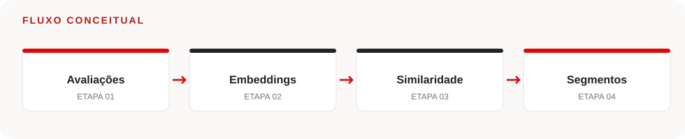

Aula 02 · Marketing analítico

# Do texto ao mapa dos consumidores

120 minutos60 min de conceitos60 min de aplicaçãoCodex · 100% por prompts

<strong>Pergunta da aula:</strong> Como comparar milhares de percepções expressas em linguagem natural?

## Abertura · 10 minutos

A aula começa com a verificação da atividade entregue após a Aula 1. O aluno deve ter executado a aplicação em casa, registrado resultados e respondido às questões do handout. O quiz verifica a análise, não a escrita de código.

## 1. O problema de decisão

A equipe já consegue interpretar avaliações, mas quer reconhecer padrões. Dois consumidores podem descrever o mesmo problema com palavras diferentes. Duas marcas podem receber elogios semelhantes por razões comerciais distintas. Representar textos por vetores permite comparar semelhanças e identificar grupos de mensagens. A aula termina distinguindo grupos de avaliações de segmentos efetivos de consumidores, distinção indispensável para Marketing Analítico.

**Objetivo ao final do encontro:** saber explicar o mecanismo central, reconhecê-lo em exemplos pequenos e construir uma aplicação que permita observar seus limites.

## 2. Construção dos conceitos · 35 minutos

### 1. Embeddings

Um texto é associado a um vetor numérico produzido por um modelo de representação. Dimensões não precisam possuir rótulos comerciais interpretáveis.

### 2. Similaridade cosseno

O quociente entre o produto interno e o produto das normas compara a orientação de dois vetores não nulos.

### 3. Projeção bidimensional

Uma figura em duas dimensões pode revelar estrutura, mas inevitavelmente perde alguma informação de um espaço de alta dimensão.

### 4. Unidade de análise

Agrupar mensagens não equivale a segmentar pessoas. Segmentação requer dados por consumidor, critérios explícitos e validação das interpretações.

### Erros de interpretação frequentes

Não confundir cosseno com distância euclidiana, mapa 2D com o espaço original ou cluster de textos com segmentação de compradores.

## 3. Exemplo mínimo · 15 minutos

**Situação.** Considere u=(1,0), v=(0,8;0,6) e w=(0,1). Todos têm norma 1. Portanto cos(u,v)=0,8 e cos(u,w)=0. A primeira dupla é mais alinhada. Isso é uma propriedade geométrica, não prova que seus autores são consumidores substituíveis.

**Resolução e interpretação.** Produto interno u·v=0,8; normas iguais a 1; similaridade 0,8. Para u·w=0; similaridade 0.

**Para resolver em papel.** Calcule cos((1,0),(0,6;0,8)) e cos((1,0),(0,1)); indique qual par tem maior similaridade.

A resolução deve explicitar as premissas antes de calcular ou interpretar um resultado. O objetivo não é reproduzir a interface da aplicação, mas compreender a estrutura lógica que ela implementa.

## 4. Simulador interativo

Use os controles para modificar uma hipótese e observar a consequência. O simulador é intencionalmente reduzido.

<iframe class="sim-frame" src="../../assets/simuladores/02.html" title="Vetores e similaridade cosseno" loading="lazy"></iframe>

[Abrir o simulador em uma nova página](../../assets/simuladores/02.html) · [Apresentação da aula](slides/aula.html) · [Notebook da aula](aula.ipynb)

## 5. Laboratório com Codex · 50 minutos

**Aplicação:** Mapa exploratório de avaliações e perfis de consumidores, com filtros por marca, tema e atributo.

A construção será feita inteiramente por prompts. O aluno pode inspecionar o código e pedir explicações, mas não editar linhas manualmente. O professor fornece uma versão de referência quando houver dependência de uma aula anterior.

### Prompt inicial para o Codex

> Amplie o laboratório de avaliações. Calcule embeddings e similaridade, faça um mapa 2D e permita examinar os textos originais. Quando houver customer_id, crie agregações por consumidor e compare grupos de mensagens com grupos de consumidores. Caso a rota de modelo não esteja disponível, execute uma representação textual local determinística e identifique-a claramente. Documente limitações da projeção.

### Três testes de aceitação

1. Mensagens com sinônimos.
2. Dois consumidores com avaliações divergentes.
3. Clusters instáveis ao mudar a quantidade de grupos.

## Duas rotas de execução

As duas alternativas são oferecidas no mesmo projeto. **Nenhuma exige escrever código manualmente.** A diferença está no modo de executar funcionalidades que dependem de um modelo.

=== "Rota A · API"

    1. Peça ao Codex para preparar a integração pelo SDK Python da OpenAI, com credencial em variável de ambiente e nunca no repositório.
    2. Solicite que ele execute testes com o conjunto local e, quando a API estiver autorizada, testes com modelo remoto.
    3. Compare as saídas e registre modelo, parâmetros, data e custos quando disponíveis.

=== "Rota B · Codex CLI / Python SDK"

    1. Autentique-se no Codex com a licença institucional disponível e abra a pasta do projeto.
    2. Solicite ao Codex, pela interface ou CLI, que execute a mesma tarefa em lotes sobre os arquivos locais, produzindo saídas estruturadas para conferência.
    3. Para automação supervisionada, o SDK Python `openai-codex` permite iniciar threads autenticadas no Codex e receber resultados. Essa alternativa **não equivale automaticamente a uma API de inferência em tempo real**. Use os resultados gerados em lote no laboratório local.

O laboratório inclui ainda uma demonstração determinística, que pode ser executada sem credenciais. [Detalhes técnicos e limites das rotas](../../programa/codex.md).

## 6. Verificação conceitual · 10 minutos

## 7. Atividade domiciliar

**Enunciado.** Use um segundo mercado de consumo, com descrições de produtos e pelo menos duas avaliações por consumidor, para construir um mapa exploratório e justificar duas hipóteses de segmentação.

**Pergunta a responder.** O agrupamento de textos corresponde necessariamente ao agrupamento de consumidores?

**Entrega:** aplicação funcional, registro de pelo menos três testes (entrada, resultado, avaliação) e uma nota analítica de até uma página. Todo código será produzido pelo Codex.

[Handout da atividade](handout.md) · [Caderno de atividades](../../caderno/index.md)

## 8. Encadeamento

Na Aula 6, esse laboratório será retomado para combinar proximidade de marca com preços e market share.
