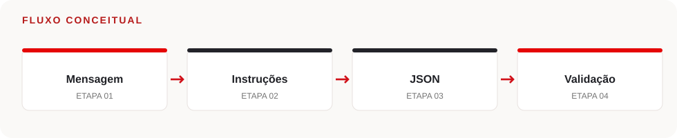

Aula 03 · Atendimento e operações

# Quando o LLM vira uma função de negócios

120 minutos60 min de conceitos60 min de aplicaçãoCodex · 100% por prompts

<strong>Pergunta da aula:</strong> Como transformar uma mensagem informal em dados seguros para um processo empresarial?

## Abertura · 10 minutos

A aula começa com a verificação da atividade entregue após a Aula 2. O aluno deve ter executado a aplicação em casa, registrado resultados e respondido às questões do handout. O quiz verifica a análise, não a escrita de código.

## 1. O problema de decisão

Uma central de atendimento recebe pedidos de rastreamento, cancelamento, reembolso e suporte. O operador não precisa de um ensaio: precisa de categoria, identificador e campos que possam ser verificados. Um LLM passa a atuar como componente de uma aplicação. O valor comercial depende de transformar linguagem em dados estruturados sem preencher lacunas por suposição.

**Objetivo ao final do encontro:** saber explicar o mecanismo central, reconhecê-lo em exemplos pequenos e construir uma aplicação que permita observar seus limites.

## 2. Construção dos conceitos · 35 minutos

### 1. Prompt como contrato

Especificar tarefa, escopo, categorias permitidas, formato e comportamento diante de informação ausente.

### 2. Saída estruturada

JSON e esquemas distinguem objetos, listas, números, booleanos e campos nulos.

### 3. Validação

Conformidade de esquema verifica forma; comparação com referência verifica significado.

### 4. Exceções

Uma mensagem ambígua exige indicação de incerteza ou encaminhamento, não inventar um número de pedido.

### Erros de interpretação frequentes

Não confundir um objeto JSON bem formado com resultado correto. Evitar instruções do cliente capazes de sobrescrever a política de classificação.

## 3. Exemplo mínimo · 15 minutos

**Situação.** Mensagem: “Meu pedido P0531 está atrasado; quero a previsão.” Campos esperados: category=delivery, order_id=P0531, issue=delay. A mensagem não informa uma data de entrega confirmada: delivery_date deve permanecer ausente ou nulo.

**Resolução e interpretação.** Uma saída com delivery_date="amanhã" pode ser JSON válido, mas não é semanticamente justificada. A validade estrutural e a validade factual são propriedades diferentes.

**Para resolver em papel.** Classifique uma lista de registros em três classes: JSON inválido, JSON válido com campos incorretos, JSON válido e coerente.

A resolução deve explicitar as premissas antes de calcular ou interpretar um resultado. O objetivo não é reproduzir a interface da aplicação, mas compreender a estrutura lógica que ela implementa.

## 4. Simulador interativo

Use os controles para modificar uma hipótese e observar a consequência. O simulador é intencionalmente reduzido.

<iframe class="sim-frame" src="../../assets/simuladores/03.html" title="Mensagem → registro → validação" loading="lazy"></iframe>

[Abrir o simulador em uma nova página](../../assets/simuladores/03.html) · [Apresentação da aula](slides/aula.html) · [Notebook da aula](aula.ipynb)

## 5. Laboratório com Codex · 50 minutos

**Aplicação:** Triagem de mensagens de clientes em registros validados com campos e categorias explícitos.

A construção será feita inteiramente por prompts. O aluno pode inspecionar o código e pedir explicações, mas não editar linhas manualmente. O professor fornece uma versão de referência quando houver dependência de uma aula anterior.

### Prompt inicial para o Codex

> Crie uma aplicação local para ler dados/support_messages.csv. Para cada mensagem, produza um registro com category, order_id, urgency, requires_human e missing_fields. Valide o esquema e exiba lado a lado a mensagem e o registro. Implemente as duas opções de acesso a modelos e uma demonstração determinística verificável. A aplicação nunca deve assumir dados ausentes.

### Três testes de aceitação

1. Pedido sem número.
2. Mensagem com múltiplas solicitações.
3. Campo de urgência sem evidência.

## Duas rotas de execução

As duas alternativas são oferecidas no mesmo projeto. **Nenhuma exige escrever código manualmente.** A diferença está no modo de executar funcionalidades que dependem de um modelo.

=== "Rota A · API"

    1. Peça ao Codex para preparar a integração pelo SDK Python da OpenAI, com credencial em variável de ambiente e nunca no repositório.
    2. Solicite que ele execute testes com o conjunto local e, quando a API estiver autorizada, testes com modelo remoto.
    3. Compare as saídas e registre modelo, parâmetros, data e custos quando disponíveis.

=== "Rota B · Codex CLI / Python SDK"

    1. Autentique-se no Codex com a licença institucional disponível e abra a pasta do projeto.
    2. Solicite ao Codex, pela interface ou CLI, que execute a mesma tarefa em lotes sobre os arquivos locais, produzindo saídas estruturadas para conferência.
    3. Para automação supervisionada, o SDK Python `openai-codex` permite iniciar threads autenticadas no Codex e receber resultados. Essa alternativa **não equivale automaticamente a uma API de inferência em tempo real**. Use os resultados gerados em lote no laboratório local.

O laboratório inclui ainda uma demonstração determinística, que pode ser executada sem credenciais. [Detalhes técnicos e limites das rotas](../../programa/codex.md).

## 6. Verificação conceitual · 10 minutos

## 7. Atividade domiciliar

**Enunciado.** Receba mensagens de uma empresa de serviços, não de varejo, e faça o Codex construir a versão de triagem com esquema adaptado a esse setor.

**Pergunta a responder.** Em qual caso a saída passou na validação do esquema e mesmo assim interpretou mal a solicitação?

**Entrega:** aplicação funcional, registro de pelo menos três testes (entrada, resultado, avaliação) e uma nota analítica de até uma página. Todo código será produzido pelo Codex.

[Handout da atividade](handout.md) · [Caderno de atividades](../../caderno/index.md)

## 8. Encadeamento

Na Aula 4, a triagem será avaliada contra exemplos com respostas verificadas.
