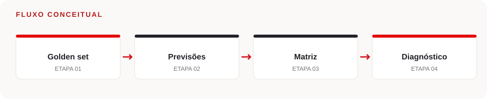

Aula 04 · Atendimento e operações

# Podemos confiar na triagem automática?

120 minutos60 min de conceitos60 min de aplicaçãoCodex · 100% por prompts

<strong>Pergunta da aula:</strong> Por que alguns exemplos corretos não bastam para aprovar uma aplicação?

## Abertura · 10 minutos

A aula começa com a verificação da atividade entregue após a Aula 3. O aluno deve ter executado a aplicação em casa, registrado resultados e respondido às questões do handout. O quiz verifica a análise, não a escrita de código.

## 1. O problema de decisão

A equipe observa bons resultados na demonstração, mas a empresa precisa saber a frequência e o tipo dos erros. O professor apresenta um conjunto de mensagens rotuladas por revisores. O trabalho passa de “parece funcionar” para uma avaliação com critérios, métricas e casos difíceis. Uma alteração de prompt poderá corrigir um defeito e criar outro.

**Objetivo ao final do encontro:** saber explicar o mecanismo central, reconhecê-lo em exemplos pequenos e construir uma aplicação que permita observar seus limites.

## 2. Construção dos conceitos · 35 minutos

### 1. Golden set

Conjunto de entradas com saídas de referência e protocolo de rotulagem.

### 2. Acurácia

Proporção de casos classificados corretamente, dependente da amostra.

### 3. Matriz de confusão

Contagens por classe verdadeira e classe prevista; permite distinguir falsos positivos de falsos negativos.

### 4. Custos assimétricos

Deixar de encaminhar um caso grave pode ser mais danoso que pedir revisão humana em excesso.

### Erros de interpretação frequentes

Não reutilizar o mesmo conjunto indefinidamente para ajustar o prompt; não tratar a base sintética como estimativa representativa da operação real.

## 3. Exemplo mínimo · 15 minutos

**Situação.** Seis mensagens têm a referência Sim,Não,Sim,Não,Sim,Não e o sistema responde Sim,Não,Não,Não,Sim,Não. São cinco acertos: acurácia 5/6. O erro foi um falso negativo, pois um caso que exigia encaminhamento foi classificado como Não.

**Resolução e interpretação.** 5÷6≈83,3%. Para encaminhamento humano, VP=2, VN=3, FN=1 e FP=0. A métrica agregada não mostra sozinha a consequência do FN.

**Para resolver em papel.** Em seis casos, calcule acurácia e identifique o tipo de erro quando o sistema prevê Não e a referência é Sim.

A resolução deve explicitar as premissas antes de calcular ou interpretar um resultado. O objetivo não é reproduzir a interface da aplicação, mas compreender a estrutura lógica que ela implementa.

## 4. Simulador interativo

Use os controles para modificar uma hipótese e observar a consequência. O simulador é intencionalmente reduzido.

<iframe class="sim-frame" src="../../assets/simuladores/04.html" title="Matriz de confusão" loading="lazy"></iframe>

[Abrir o simulador em uma nova página](../../assets/simuladores/04.html) · [Apresentação da aula](slides/aula.html) · [Notebook da aula](aula.ipynb)

## 5. Laboratório com Codex · 50 minutos

**Aplicação:** Painel de avaliação da triagem, com matriz de confusão, erros individuais e comparação entre duas versões.

A construção será feita inteiramente por prompts. O aluno pode inspecionar o código e pedir explicações, mas não editar linhas manualmente. O professor fornece uma versão de referência quando houver dependência de uma aula anterior.

### Prompt inicial para o Codex

> Amplie a aplicação de triagem com golden set. Compare duas versões usando exatamente as mesmas mensagens. Calcule acurácia, matriz de confusão, erros por categoria e exemplos de falso negativo. Inclua ao menos um texto que tente alterar as instruções do sistema e mostre que ele deve ser tratado como dado. Registre a versão avaliada.

### Três testes de aceitação

1. Um falso negativo de prioridade alta.
2. Mudança que corrige um caso e piora outro.
3. Mensagem de cliente com instrução maliciosa.

## Duas rotas de execução

As duas alternativas são oferecidas no mesmo projeto. **Nenhuma exige escrever código manualmente.** A diferença está no modo de executar funcionalidades que dependem de um modelo.

=== "Rota A · API"

    1. Peça ao Codex para preparar a integração pelo SDK Python da OpenAI, com credencial em variável de ambiente e nunca no repositório.
    2. Solicite que ele execute testes com o conjunto local e, quando a API estiver autorizada, testes com modelo remoto.
    3. Compare as saídas e registre modelo, parâmetros, data e custos quando disponíveis.

=== "Rota B · Codex CLI / Python SDK"

    1. Autentique-se no Codex com a licença institucional disponível e abra a pasta do projeto.
    2. Solicite ao Codex, pela interface ou CLI, que execute a mesma tarefa em lotes sobre os arquivos locais, produzindo saídas estruturadas para conferência.
    3. Para automação supervisionada, o SDK Python `openai-codex` permite iniciar threads autenticadas no Codex e receber resultados. Essa alternativa **não equivale automaticamente a uma API de inferência em tempo real**. Use os resultados gerados em lote no laboratório local.

O laboratório inclui ainda uma demonstração determinística, que pode ser executada sem credenciais. [Detalhes técnicos e limites das rotas](../../programa/codex.md).

## 6. Verificação conceitual · 10 minutos

## 7. Atividade domiciliar

**Enunciado.** Avalie a triagem criada em casa na Aula 3 com um segundo golden set e produza uma nota de decisão sobre seu uso supervisionado.

**Pergunta a responder.** Um aumento pequeno de acurácia basta para autorizar a automação?

**Entrega:** aplicação funcional, registro de pelo menos três testes (entrada, resultado, avaliação) e uma nota analítica de até uma página. Todo código será produzido pelo Codex.

[Handout da atividade](handout.md) · [Caderno de atividades](../../caderno/index.md)

## 8. Encadeamento

O sistema voltará na Aula 10, quando receberá consultas documentais e será avaliado experimentalmente.
