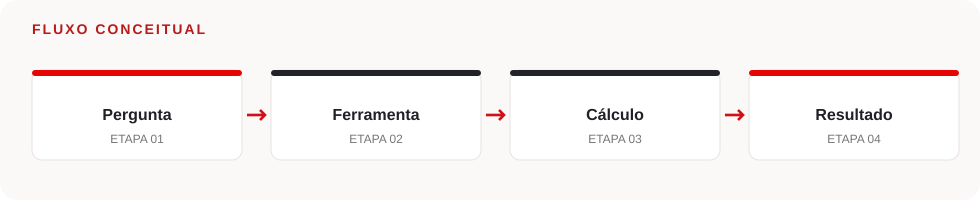

Aula 05 · Investimentos

# Um assistente que calcula, não adivinha

120 minutos60 min de conceitos60 min de aplicaçãoCodex · 100% por prompts

<strong>Pergunta da aula:</strong> Como impedir que um LLM invente retornos, covariâncias ou pesos ótimos?

## Abertura · 10 minutos

A aula começa com a verificação da atividade entregue após a Aula 4. O aluno deve ter executado a aplicação em casa, registrado resultados e respondido às questões do handout. O quiz verifica a análise, não a escrita de código.

## 1. O problema de decisão

Um analista deseja comparar carteiras e visualizar a fronteira eficiente. Os alunos já conhecem Markowitz, CAPM e Sharpe; não precisam reaprender teoria de portfólios. A novidade é arquitetural: o LLM interpreta a solicitação e coordena funções que buscam preços e realizam cálculos determinísticos. O interesse didático está nos argumentos e nos rastros, e não em aceitar números plausíveis.

**Objetivo ao final do encontro:** saber explicar o mecanismo central, reconhecê-lo em exemplos pequenos e construir uma aplicação que permita observar seus limites.

## 2. Construção dos conceitos · 35 minutos

### 1. Tool calling

O modelo solicita a execução de uma função, mas o código da aplicação é responsável pela execução e validação dos argumentos.

### 2. Contratos de ferramenta

Entradas, unidades e saídas têm especificações. Taxa anual não pode ser misturada com retorno diário sem conversão.

### 3. Cálculo determinístico

Retornos, covariâncias e otimização devem ser executados e verificados, não produzidos por fluência textual.

### 4. Rastreabilidade

Toda conclusão sobre uma carteira deve ligar-se aos dados, ao período, às restrições e às ferramentas chamadas.

### Erros de interpretação frequentes

Não tratar preços simulados como recomendações; não afirmar retorno futuro; não omitir frequência, custos, taxa livre de risco ou restrições.

## 3. Exemplo mínimo · 15 minutos

**Situação.** Dois ativos: retornos esperados de 8% e 12%; volatilidades de 10% e 20%; correlação zero; pesos 50% e 50%. Retorno da carteira = 10%. Variância = (0,5²×0,10²)+(0,5²×0,20²)=0,0125. Volatilidade ≈11,18%.

**Resolução e interpretação.** A ferramenta de portfólio deve receber dois pesos, dois retornos, duas volatilidades e a correlação. Sem correlação, calcular a volatilidade com média simples de 10% e 20% seria incorreto.

**Para resolver em papel.** Reconstrua os argumentos de calculate_portfolio_variance para os dois ativos e confira a resposta.

A resolução deve explicitar as premissas antes de calcular ou interpretar um resultado. O objetivo não é reproduzir a interface da aplicação, mas compreender a estrutura lógica que ela implementa.

## 4. Simulador interativo

Use os controles para modificar uma hipótese e observar a consequência. O simulador é intencionalmente reduzido.

<iframe class="sim-frame" src="../../assets/simuladores/05.html" title="Tool calling e risco de carteira" loading="lazy"></iframe>

[Abrir o simulador em uma nova página](../../assets/simuladores/05.html) · [Apresentação da aula](slides/aula.html) · [Notebook da aula](aula.ipynb)

## 5. Laboratório com Codex · 50 minutos

**Aplicação:** Laboratório de carteiras com preços históricos verificáveis, cálculo de retorno, risco, índice de Sharpe e fronteira eficiente.

A construção será feita inteiramente por prompts. O aluno pode inspecionar o código e pedir explicações, mas não editar linhas manualmente. O professor fornece uma versão de referência quando houver dependência de uma aula anterior.

### Prompt inicial para o Codex

> Construa um laboratório de portfólios usando dados/prices_simulated.csv, com ferramentas separadas para ler preços, calcular retornos, estimar covariâncias, calcular Sharpe e otimizar pesos sob restrições. Mostre período, frequência, unidades, hipóteses e rastro de cada ferramenta. Desenhe a fronteira eficiente quando houver dados suficientes. Ofereça um modo de reprodução integral usando somente dados locais.

### Três testes de aceitação

1. Pesos que não somam 1.
2. Taxa livre de risco incoerente em frequência.
3. Ativo sem dados no período escolhido.

## Duas rotas de execução

As duas alternativas são oferecidas no mesmo projeto. **Nenhuma exige escrever código manualmente.** A diferença está no modo de executar funcionalidades que dependem de um modelo.

=== "Rota A · API"

    1. Peça ao Codex para preparar a integração pelo SDK Python da OpenAI, com credencial em variável de ambiente e nunca no repositório.
    2. Solicite que ele execute testes com o conjunto local e, quando a API estiver autorizada, testes com modelo remoto.
    3. Compare as saídas e registre modelo, parâmetros, data e custos quando disponíveis.

=== "Rota B · Codex CLI / Python SDK"

    1. Autentique-se no Codex com a licença institucional disponível e abra a pasta do projeto.
    2. Solicite ao Codex, pela interface ou CLI, que execute a mesma tarefa em lotes sobre os arquivos locais, produzindo saídas estruturadas para conferência.
    3. Para automação supervisionada, o SDK Python `openai-codex` permite iniciar threads autenticadas no Codex e receber resultados. Essa alternativa **não equivale automaticamente a uma API de inferência em tempo real**. Use os resultados gerados em lote no laboratório local.

O laboratório inclui ainda uma demonstração determinística, que pode ser executada sem credenciais. [Detalhes técnicos e limites das rotas](../../programa/codex.md).

## 6. Verificação conceitual · 10 minutos

## 7. Atividade domiciliar

**Enunciado.** Receba uma série distinta de quatro ativos fictícios. Replique o laboratório e compare a carteira de pesos iguais com a carteira de máximo Sharpe sob restrição sem venda a descoberto.

**Pergunta a responder.** Qual resultado depende de uma hipótese de modelagem que precisa aparecer na interface?

**Entrega:** aplicação funcional, registro de pelo menos três testes (entrada, resultado, avaliação) e uma nota analítica de até uma página. Todo código será produzido pelo Codex.

[Handout da atividade](handout.md) · [Caderno de atividades](../../caderno/index.md)

## 8. Encadeamento

Na Aula 6, ferramentas serão combinadas em uma análise empresarial com várias fontes.
