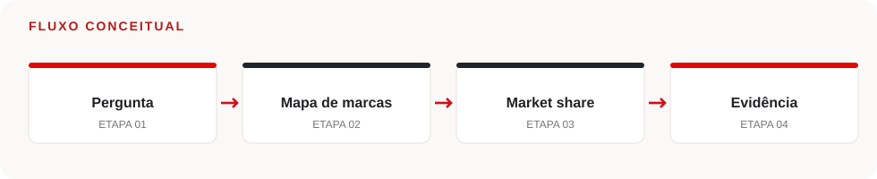

Aula 06 · Marketing analítico

# Quando a IA combina informações

120 minutos60 min de conceitos60 min de aplicaçãoCodex · 100% por prompts

<strong>Pergunta da aula:</strong> Uma resposta correta é suficiente se o sistema não consultou a evidência necessária?

## Abertura · 10 minutos

A aula começa com a verificação da atividade entregue após a Aula 5. O aluno deve ter executado a aplicação em casa, registrado resultados e respondido às questões do handout. O quiz verifica a análise, não a escrita de código.

## 1. O problema de decisão

A equipe retoma o painel de percepções dos consumidores. Agora deseja saber qual marca concorre mais diretamente com Atlas e se está crescendo. A resposta exige dois tipos de informação: proximidade no posicionamento e variação da participação de mercado. Um agente que consulta apenas o mapa e inventa a participação poderia acertar por acaso. A aula introduz composição de ferramentas, dependências e rastros auditáveis.

**Objetivo ao final do encontro:** saber explicar o mecanismo central, reconhecê-lo em exemplos pequenos e construir uma aplicação que permita observar seus limites.

## 2. Construção dos conceitos · 35 minutos

### 1. Composição

Uma pergunta pode exigir mais de uma operação encadeada.

### 2. Dependência entre resultados

O resultado de identificar a concorrente mais próxima determina qual marca deve ser consultada na segunda ferramenta.

### 3. Rastro de execução

Chamadas, argumentos, respostas e ordem revelam como a conclusão foi formada.

### 4. Evidência suficiente

A conclusão deve ser limitada ao que as ferramentas realmente retornaram; uma afirmação correta sem suporte ainda é uma falha de processo.

### Erros de interpretação frequentes

Não inferir market share de frequência de avaliações; não confundir proximidade de marca com causalidade de escolhas do consumidor.

## 3. Exemplo mínimo · 15 minutos

**Situação.** O mapa aponta Brava como concorrente mais próxima de Atlas. A participação de Brava passa de 19% a 22%. Logo, aumentou três pontos percentuais. Se só a participação de 2026 foi consultada, afirmar a variação sem buscar 2025 é injustificado.

**Resolução e interpretação.** Três pontos percentuais ≠ crescimento relativo de 3%. Crescimento relativo = (22−19)/19≈15,8%. A interface deve distinguir ambos.

**Para resolver em papel.** Se uma marca muda de 12% para 15%, calcule variação em pontos percentuais e percentual relativo.

A resolução deve explicitar as premissas antes de calcular ou interpretar um resultado. O objetivo não é reproduzir a interface da aplicação, mas compreender a estrutura lógica que ela implementa.

## 4. Simulador interativo

Use os controles para modificar uma hipótese e observar a consequência. O simulador é intencionalmente reduzido.

<iframe class="sim-frame" src="../../assets/simuladores/06.html" title="Sequência de ferramentas e evidências" loading="lazy"></iframe>

[Abrir o simulador em uma nova página](../../assets/simuladores/06.html) · [Apresentação da aula](slides/aula.html) · [Notebook da aula](aula.ipynb)

## 5. Laboratório com Codex · 50 minutos

**Aplicação:** Assistente de inteligência competitiva que combina avaliações, mapa de posicionamento, preços e participação.

A construção será feita inteiramente por prompts. O aluno pode inspecionar o código e pedir explicações, mas não editar linhas manualmente. O professor fornece uma versão de referência quando houver dependência de uma aula anterior.

### Prompt inicial para o Codex

> Retome o laboratório de Marketing. Crie ferramentas para consultar marcas, atributos, avaliações, preços e market share em dados/brands_market.csv. Para perguntas que dependam de mais de uma fonte, exiba argumentos e resultados de cada ferramenta e cite exatamente a origem da conclusão. Gere casos de teste com dados ausentes e com chamadas em ordem errada.

### Três testes de aceitação

1. Marca mais próxima sem participação disponível.
2. Cálculo de variação em pontos percentuais.
3. Resposta plausível com chamada faltando.

## Duas rotas de execução

As duas alternativas são oferecidas no mesmo projeto. **Nenhuma exige escrever código manualmente.** A diferença está no modo de executar funcionalidades que dependem de um modelo.

=== "Rota A · API"

    1. Peça ao Codex para preparar a integração pelo SDK Python da OpenAI, com credencial em variável de ambiente e nunca no repositório.
    2. Solicite que ele execute testes com o conjunto local e, quando a API estiver autorizada, testes com modelo remoto.
    3. Compare as saídas e registre modelo, parâmetros, data e custos quando disponíveis.

=== "Rota B · Codex CLI / Python SDK"

    1. Autentique-se no Codex com a licença institucional disponível e abra a pasta do projeto.
    2. Solicite ao Codex, pela interface ou CLI, que execute a mesma tarefa em lotes sobre os arquivos locais, produzindo saídas estruturadas para conferência.
    3. Para automação supervisionada, o SDK Python `openai-codex` permite iniciar threads autenticadas no Codex e receber resultados. Essa alternativa **não equivale automaticamente a uma API de inferência em tempo real**. Use os resultados gerados em lote no laboratório local.

O laboratório inclui ainda uma demonstração determinística, que pode ser executada sem credenciais. [Detalhes técnicos e limites das rotas](../../programa/codex.md).

## 6. Verificação conceitual · 10 minutos

## 7. Atividade domiciliar

**Enunciado.** Use outro setor com quatro marcas e dados artificiais de preços, qualidade e participação; investigue a concorrente mais próxima e audite a trajetória do assistente.

**Pergunta a responder.** O assistente pode afirmar crescimento sem consultar os dois períodos?

**Entrega:** aplicação funcional, registro de pelo menos três testes (entrada, resultado, avaliação) e uma nota analítica de até uma página. Todo código será produzido pelo Codex.

[Handout da atividade](handout.md) · [Caderno de atividades](../../caderno/index.md)

## 8. Encadeamento

Na Aula 7, ferramentas de pesquisa recuperarão evidências em documentos completos.
