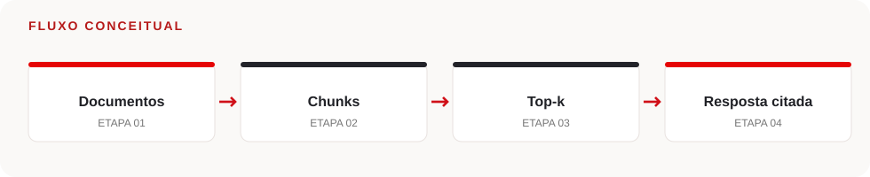

Aula 07 · Macroeconomia

# A IA precisa mostrar suas fontes

120 minutos60 min de conceitos60 min de aplicaçãoCodex · 100% por prompts

<strong>Pergunta da aula:</strong> Como responder a uma questão econômica sustentando cada afirmação em documentos oficiais?

## Abertura · 10 minutos

A aula começa com a verificação da atividade entregue após a Aula 6. O aluno deve ter executado a aplicação em casa, registrado resultados e respondido às questões do handout. O quiz verifica a análise, não a escrita de código.

## 1. O problema de decisão

Um analista quer comparar como o Copom discute riscos de inflação ao longo do tempo. A resposta exige documentos específicos e cuidado com datas, escopo e atribuições. Na aula, os alunos constroem um sistema que divide textos, recupera trechos e produz respostas com fontes. Primeiro utilizam documentos didáticos; depois podem conectar as atas oficiais, identificando claramente sua origem.

**Objetivo ao final do encontro:** saber explicar o mecanismo central, reconhecê-lo em exemplos pequenos e construir uma aplicação que permita observar seus limites.

## 2. Construção dos conceitos · 35 minutos

### 1. Ingestão e chunking

Documentos são transformados em unidades de recuperação. Fronteiras mal escolhidas podem separar uma regra de sua exceção.

### 2. Embeddings e índice

Os chunks são representados e armazenados para busca semântica.

### 3. Top-k

A busca seleciona um subconjunto de trechos. Aumentar k altera custo e cobertura, sem garantir qualidade.

### 4. Recuperação versus geração

O sistema pode falhar porque não recuperou a evidência ou porque interpretou mal a evidência recuperada.

### Erros de interpretação frequentes

Não apresentar documentos sintéticos como atas reais. Não confundir interpretação do analista com comunicado oficial do órgão.

## 3. Exemplo mínimo · 15 minutos

**Situação.** O documento A afirma “risco externo elevado”. O documento B acrescenta “persistência de serviços”. A pergunta compara a ênfase nas duas reuniões. Recuperar apenas B permite identificar o tema, mas não sustenta a comparação temporal.

**Resolução e interpretação.** Para comparar duas reuniões, é preciso ao menos uma passagem pertinente de cada período. Um texto inventado que não aparece em nenhuma fonte não pode receber uma citação válida.

**Para resolver em papel.** Receba três chunks e uma pergunta comparativa; selecione quais trechos precisariam ser recuperados e justifique.

A resolução deve explicitar as premissas antes de calcular ou interpretar um resultado. O objetivo não é reproduzir a interface da aplicação, mas compreender a estrutura lógica que ela implementa.

## 4. Simulador interativo

Use os controles para modificar uma hipótese e observar a consequência. O simulador é intencionalmente reduzido.

<iframe class="sim-frame" src="../../assets/simuladores/07.html" title="Ingestão → busca → evidência → resposta" loading="lazy"></iframe>

[Abrir o simulador em uma nova página](../../assets/simuladores/07.html) · [Apresentação da aula](slides/aula.html) · [Notebook da aula](aula.ipynb)

## 5. Laboratório com Codex · 50 minutos

**Aplicação:** Explorador documental do Copom, com recuperação top-k, fontes, datas e comparação textual.

A construção será feita inteiramente por prompts. O aluno pode inspecionar o código e pedir explicações, mas não editar linhas manualmente. O professor fornece uma versão de referência quando houver dependência de uma aula anterior.

### Prompt inicial para o Codex

> Construa um RAG sobre dados/copom. Preserve nome, data e natureza de cada documento. Mostre chunks, pontuações de busca, top-k e fontes junto da resposta. Identifique claramente os documentos didáticos como fictícios. Acrescente opção para carregar atas oficiais fornecidas pelo usuário, sem afirmar decisões não verificadas. Mostre os casos em que a recuperação falha.

### Três testes de aceitação

1. Pergunta comparativa com apenas um documento encontrado.
2. Trecho sem data.
3. Resposta que excede a evidência.

## Duas rotas de execução

As duas alternativas são oferecidas no mesmo projeto. **Nenhuma exige escrever código manualmente.** A diferença está no modo de executar funcionalidades que dependem de um modelo.

=== "Rota A · API"

    1. Peça ao Codex para preparar a integração pelo SDK Python da OpenAI, com credencial em variável de ambiente e nunca no repositório.
    2. Solicite que ele execute testes com o conjunto local e, quando a API estiver autorizada, testes com modelo remoto.
    3. Compare as saídas e registre modelo, parâmetros, data e custos quando disponíveis.

=== "Rota B · Codex CLI / Python SDK"

    1. Autentique-se no Codex com a licença institucional disponível e abra a pasta do projeto.
    2. Solicite ao Codex, pela interface ou CLI, que execute a mesma tarefa em lotes sobre os arquivos locais, produzindo saídas estruturadas para conferência.
    3. Para automação supervisionada, o SDK Python `openai-codex` permite iniciar threads autenticadas no Codex e receber resultados. Essa alternativa **não equivale automaticamente a uma API de inferência em tempo real**. Use os resultados gerados em lote no laboratório local.

O laboratório inclui ainda uma demonstração determinística, que pode ser executada sem credenciais. [Detalhes técnicos e limites das rotas](../../programa/codex.md).

## 6. Verificação conceitual · 10 minutos

## 7. Atividade domiciliar

**Enunciado.** Use comunicados econômicos distintos dos trabalhados em aula, com duas datas verificadas, e produza uma comparação cujo texto separe citação, paráfrase e interpretação.

**Pergunta a responder.** Uma resposta correta sem fonte rastreável atende ao objetivo de um RAG econômico?

**Entrega:** aplicação funcional, registro de pelo menos três testes (entrada, resultado, avaliação) e uma nota analítica de até uma página. Todo código será produzido pelo Codex.

[Handout da atividade](handout.md) · [Caderno de atividades](../../caderno/index.md)

## 8. Encadeamento

Na Aula 8, essa arquitetura passa a considerar perguntas dependentes de uma conversa.
