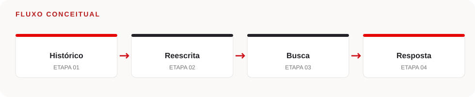

Aula 08 · Pesquisa de investimentos

# Uma IA que acompanha a conversa

120 minutos60 min de conceitos60 min de aplicaçãoCodex · 100% por prompts

<strong>Pergunta da aula:</strong> Como um sistema entende “E a do outro fundo?” sem perder a referência?

## Abertura · 10 minutos

A aula começa com a verificação da atividade entregue após a Aula 7. O aluno deve ter executado a aplicação em casa, registrado resultados e respondido às questões do handout. O quiz verifica a análise, não a escrita de código.

## 1. O problema de decisão

Uma pessoa compara taxas e políticas de fundos. Após perguntar pela taxa do Horizonte, diz apenas “E a do Delta?”. Uma busca independente pode falhar, pois a segunda pergunta omite o atributo. O sistema precisa reconstruir uma pergunta completa a partir do histórico. A aula ensina a diferença entre manter a conversa, reescrever a consulta e recuperar a evidência correta.

**Objetivo ao final do encontro:** saber explicar o mecanismo central, reconhecê-lo em exemplos pequenos e construir uma aplicação que permita observar seus limites.

## 2. Construção dos conceitos · 35 minutos

### 1. Histórico e estado

O sistema precisa preservar quais entidades e atributos foram mencionados.

### 2. Query rewriting

Uma pergunta incompleta é transformada em consulta autônoma antes da recuperação.

### 3. Ambiguidade

Se a referência não for unívoca, é melhor pedir esclarecimento do que adivinhar.

### 4. Abstenção

Se o documento não fornece o dado, a resposta deve indicar a ausência da evidência.

### Erros de interpretação frequentes

Não transferir atributos de um fundo para outro; não inventar dados de regulamentos reais.

## 3. Exemplo mínimo · 15 minutos

**Situação.** Pergunta 1: “Qual a taxa de administração do Fundo Horizonte?” Pergunta 2: “E a do Delta?” A consulta reescrita é “Qual a taxa de administração do Fundo Delta?”. O atributo taxa é preservado; a entidade Horizonte é substituída por Delta.

**Resolução e interpretação.** O documento didático do Delta informa 0,80% ao ano. A resposta pode usar esse número somente se recuperar o trecho correspondente, sem misturá-lo a outro custo ou produto.

**Para resolver em papel.** Reescreva “E qual é o prazo dele?” após conversa que menciona dois fundos e determine quando deve pedir esclarecimento.

A resolução deve explicitar as premissas antes de calcular ou interpretar um resultado. O objetivo não é reproduzir a interface da aplicação, mas compreender a estrutura lógica que ela implementa.

## 4. Simulador interativo

Use os controles para modificar uma hipótese e observar a consequência. O simulador é intencionalmente reduzido.

<iframe class="sim-frame" src="../../assets/simuladores/08.html" title="Histórico → reescrita → recuperação" loading="lazy"></iframe>

[Abrir o simulador em uma nova página](../../assets/simuladores/08.html) · [Apresentação da aula](slides/aula.html) · [Notebook da aula](aula.ipynb)

## 5. Laboratório com Codex · 50 minutos

**Aplicação:** Chatbot RAG para fundos e ETFs com visualização de pergunta original, reescrita e fontes.

A construção será feita inteiramente por prompts. O aluno pode inspecionar o código e pedir explicações, mas não editar linhas manualmente. O professor fornece uma versão de referência quando houver dependência de uma aula anterior.

### Prompt inicial para o Codex

> Crie um chatbot sobre dados/fundos. Mostre a pergunta do usuário, o histórico mínimo utilizado, a consulta reescrita, o ranking de documentos, o trecho escolhido e a resposta. Trate “E a do Delta?” preservando a dimensão da pergunta anterior. Para consultas não respondíveis, informe que a fonte não contém a informação. Inclua modo determinístico e opções API e Codex CLI/SDK.

### Três testes de aceitação

1. Perguntas encadeadas que mudam entidade.
2. Ambiguidade sobre duas taxas.
3. Pergunta cujo dado não existe no regulamento.

## Duas rotas de execução

As duas alternativas são oferecidas no mesmo projeto. **Nenhuma exige escrever código manualmente.** A diferença está no modo de executar funcionalidades que dependem de um modelo.

=== "Rota A · API"

    1. Peça ao Codex para preparar a integração pelo SDK Python da OpenAI, com credencial em variável de ambiente e nunca no repositório.
    2. Solicite que ele execute testes com o conjunto local e, quando a API estiver autorizada, testes com modelo remoto.
    3. Compare as saídas e registre modelo, parâmetros, data e custos quando disponíveis.

=== "Rota B · Codex CLI / Python SDK"

    1. Autentique-se no Codex com a licença institucional disponível e abra a pasta do projeto.
    2. Solicite ao Codex, pela interface ou CLI, que execute a mesma tarefa em lotes sobre os arquivos locais, produzindo saídas estruturadas para conferência.
    3. Para automação supervisionada, o SDK Python `openai-codex` permite iniciar threads autenticadas no Codex e receber resultados. Essa alternativa **não equivale automaticamente a uma API de inferência em tempo real**. Use os resultados gerados em lote no laboratório local.

O laboratório inclui ainda uma demonstração determinística, que pode ser executada sem credenciais. [Detalhes técnicos e limites das rotas](../../programa/codex.md).

## 6. Verificação conceitual · 10 minutos

## 7. Atividade domiciliar

**Enunciado.** Aplique o mesmo chatbot a um novo conjunto documental de três produtos de investimento fictícios com taxas, índice de referência e resgate; registre uma conversa de quatro turnos.

**Pergunta a responder.** Quando reescrever a consulta melhora a busca e quando pode piorá-la?

**Entrega:** aplicação funcional, registro de pelo menos três testes (entrada, resultado, avaliação) e uma nota analítica de até uma página. Todo código será produzido pelo Codex.

[Handout da atividade](handout.md) · [Caderno de atividades](../../caderno/index.md)

## 8. Encadeamento

Na Aula 9, a busca desse chatbot será avaliada por métricas e estratégias distintas.
