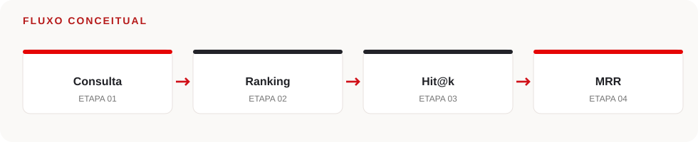

Aula 09 · Pesquisa de investimentos

# A IA encontrou a informação certa?

120 minutos60 min de conceitos60 min de aplicaçãoCodex · 100% por prompts

<strong>Pergunta da aula:</strong> Dois mecanismos recuperam os mesmos documentos: qual entrega evidência mais útil primeiro?

## Abertura · 10 minutos

A aula começa com a verificação da atividade entregue após a Aula 8. O aluno deve ter executado a aplicação em casa, registrado resultados e respondido às questões do handout. O quiz verifica a análise, não a escrita de código.

## 1. O problema de decisão

O chatbot documental recupera trechos, mas alguns aparecem muito abaixo na lista. O analista quer saber se a busca densa vale o custo e quando uma abordagem lexical mais simples é suficiente. Estabelecemos perguntas com documentos relevantes conhecidos e comparamos rankings, Hit@k e MRR. A distinção entre encontrar a informação e posicioná-la cedo se torna mensurável.

**Objetivo ao final do encontro:** saber explicar o mecanismo central, reconhecê-lo em exemplos pequenos e construir uma aplicação que permita observar seus limites.

## 2. Construção dos conceitos · 35 minutos

### 1. Relevância e golden set

A resposta de referência registra qual documento é pertinente a cada pergunta.

### 2. Hit@k

Indica se ao menos um documento relevante aparece entre as primeiras k posições.

### 3. MRR@k

Média dos recíprocos das posições do primeiro acerto, truncada em k.

### 4. Busca lexical, BM25 e busca densa

Nomes e códigos exatos favorecem frequentemente a correspondência lexical; sinônimos podem favorecer representações semânticas. A busca híbrida combina sinais.

### Erros de interpretação frequentes

Não usar a mesma pergunta para escolher e validar o melhor parâmetro; incluir consultas sem resposta e múltiplos trechos relevantes quando apropriado.

## 3. Exemplo mínimo · 15 minutos

**Situação.** Quatro questões: A tem ranks 1,3,2,5; B tem 2,2,3,5. Para k=3, ambos têm Hit@3=3/4. MRR@3(A)=(1+1/3+1/2+0)/4≈0,458; MRR@3(B)=(1/2+1/2+1/3+0)/4≈0,333.

**Resolução e interpretação.** O documento na posição cinco não pontua em k=3. A ganha no MRR porque encontra o relevante na primeira posição em uma das perguntas.

**Para resolver em papel.** Recalcule Hit@3 e MRR@3 para as quatro consultas da tabela apresentada.

A resolução deve explicitar as premissas antes de calcular ou interpretar um resultado. O objetivo não é reproduzir a interface da aplicação, mas compreender a estrutura lógica que ela implementa.

## 4. Simulador interativo

Use os controles para modificar uma hipótese e observar a consequência. O simulador é intencionalmente reduzido.

<iframe class="sim-frame" src="../../assets/simuladores/09.html" title="Ranking, Hit@k e MRR" loading="lazy"></iframe>

[Abrir o simulador em uma nova página](../../assets/simuladores/09.html) · [Apresentação da aula](slides/aula.html) · [Notebook da aula](aula.ipynb)

## 5. Laboratório com Codex · 50 minutos

**Aplicação:** Painel comparativo de busca lexical, densa e híbrida para documentos de fundos.

A construção será feita inteiramente por prompts. O aluno pode inspecionar o código e pedir explicações, mas não editar linhas manualmente. O professor fornece uma versão de referência quando houver dependência de uma aula anterior.

### Prompt inicial para o Codex

> Amplie o chatbot com avaliação de busca. Carregue dados/golden_funds.csv, compare resultados de busca lexical, representações semânticas e uma combinação híbrida; apresente rankings, Hit@1, Hit@3 e MRR@3. Indique as consultas sem resposta e os exemplos onde uma estratégia foi melhor que outra. Se a inferência semântica online não estiver disponível, explicite qual representação local foi utilizada.

### Três testes de aceitação

1. Nome exato de fundo.
2. Pergunta com sinônimos.
3. Pergunta inexistente no acervo.

## Duas rotas de execução

As duas alternativas são oferecidas no mesmo projeto. **Nenhuma exige escrever código manualmente.** A diferença está no modo de executar funcionalidades que dependem de um modelo.

=== "Rota A · API"

    1. Peça ao Codex para preparar a integração pelo SDK Python da OpenAI, com credencial em variável de ambiente e nunca no repositório.
    2. Solicite que ele execute testes com o conjunto local e, quando a API estiver autorizada, testes com modelo remoto.
    3. Compare as saídas e registre modelo, parâmetros, data e custos quando disponíveis.

=== "Rota B · Codex CLI / Python SDK"

    1. Autentique-se no Codex com a licença institucional disponível e abra a pasta do projeto.
    2. Solicite ao Codex, pela interface ou CLI, que execute a mesma tarefa em lotes sobre os arquivos locais, produzindo saídas estruturadas para conferência.
    3. Para automação supervisionada, o SDK Python `openai-codex` permite iniciar threads autenticadas no Codex e receber resultados. Essa alternativa **não equivale automaticamente a uma API de inferência em tempo real**. Use os resultados gerados em lote no laboratório local.

O laboratório inclui ainda uma demonstração determinística, que pode ser executada sem credenciais. [Detalhes técnicos e limites das rotas](../../programa/codex.md).

## 6. Verificação conceitual · 10 minutos

## 7. Atividade domiciliar

**Enunciado.** Execute as avaliações em um segundo conjunto de regulamentos fictícios e escolha uma estratégia para perguntas com termos exatos e outra para perguntas abertas, justificando o trade-off.

**Pergunta a responder.** Como duas buscas podem ter o mesmo Hit@3 e diferentes MRR@3?

**Entrega:** aplicação funcional, registro de pelo menos três testes (entrada, resultado, avaliação) e uma nota analítica de até uma página. Todo código será produzido pelo Codex.

[Handout da atividade](handout.md) · [Caderno de atividades](../../caderno/index.md)

## 8. Encadeamento

Na Aula 10, a atenção sai da busca isolada e passa para experimentos do sistema completo.
