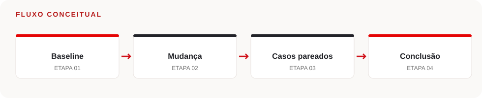

Aula 10 · Atendimento e operações

# Melhorou mesmo? Experimentos com IA

120 minutos60 min de conceitos60 min de aplicaçãoCodex · 100% por prompts

<strong>Pergunta da aula:</strong> Uma nova versão que melhora a média pode piorar casos importantes?

## Abertura · 10 minutos

A aula começa com a verificação da atividade entregue após a Aula 9. O aluno deve ter executado a aplicação em casa, registrado resultados e respondido às questões do handout. O quiz verifica a análise, não a escrita de código.

## 1. O problema de decisão

O atendimento estruturado agora precisa consultar políticas de troca, entrega e reembolso para responder corretamente. A equipe acrescenta RAG, mas deve decidir entre configurações de chunking, busca e geração. Um teste controlado pode mostrar melhora média e regressões perigosas. A aula enfatiza escolher uma hipótese, controlar variáveis, confrontar julgamento automático com referências humanas e registrar custo e latência.

**Objetivo ao final do encontro:** saber explicar o mecanismo central, reconhecê-lo em exemplos pequenos e construir uma aplicação que permita observar seus limites.

## 2. Construção dos conceitos · 35 minutos

### 1. Baseline e hipótese

Comparar uma configuração atual com uma mudança prevista, sem alterar múltiplos fatores sem registro.

### 2. Comparação pareada

As mesmas perguntas são utilizadas em ambas as versões, permitindo contar melhorias e regressões.

### 3. LLM-as-a-Judge

Um modelo avaliador ajuda a escalar análises, mas suas decisões precisam ser auditadas contra critérios e exemplos humanos.

### 4. Trade-offs

Qualidade, custo e tempo de resposta são dimensões distintas; a escolha depende da aplicação.

### Erros de interpretação frequentes

Não afirmar significância estatística com seis exemplos; não fazer o LLM-juiz avaliar sem critérios explícitos.

## 3. Exemplo mínimo · 15 minutos

**Situação.** Seis casos: antes acerta Q1,Q3,Q4,Q6; depois acerta Q1,Q2,Q4,Q5,Q6. A acurácia vai de 4/6 a 5/6; há duas melhorias (Q2,Q5) e uma regressão (Q3). Uma conclusão baseada somente no agregado esconde Q3.

**Resolução e interpretação.** Ganho líquido de 1 acerto; taxa inicial≈66,7%, final≈83,3%. A melhoria precisa ser interpretada em conjunto com a gravidade do caso regressivo.

**Para resolver em papel.** Conte acertos, melhorias e regressões da comparação antes/depois e indique qual informação adicional seria necessária.

A resolução deve explicitar as premissas antes de calcular ou interpretar um resultado. O objetivo não é reproduzir a interface da aplicação, mas compreender a estrutura lógica que ela implementa.

## 4. Simulador interativo

Use os controles para modificar uma hipótese e observar a consequência. O simulador é intencionalmente reduzido.

<iframe class="sim-frame" src="../../assets/simuladores/10.html" title="Acurácia, melhorias e regressões" loading="lazy"></iframe>

[Abrir o simulador em uma nova página](../../assets/simuladores/10.html) · [Apresentação da aula](slides/aula.html) · [Notebook da aula](aula.ipynb)

## 5. Laboratório com Codex · 50 minutos

**Aplicação:** Atendimento documental com políticas fictícias, experimentos de configuração e rastreamento de respostas.

A construção será feita inteiramente por prompts. O aluno pode inspecionar o código e pedir explicações, mas não editar linhas manualmente. O professor fornece uma versão de referência quando houver dependência de uma aula anterior.

### Prompt inicial para o Codex

> Retome o classificador de atendimento e acrescente RAG sobre dados/politicas. Avalie duas configurações nas mesmas seis ou mais solicitações de referência. Mostre texto, evidências, julgamento do avaliador automático, referência humana, melhorias e regressões. Compare também latência e número de chamadas. Não solicite nem execute reembolsos reais.

### Três testes de aceitação

1. Regra geral com exceção.
2. Resposta correta com fonte incorreta.
3. Melhoria que provoca regressão crítica.

## Duas rotas de execução

As duas alternativas são oferecidas no mesmo projeto. **Nenhuma exige escrever código manualmente.** A diferença está no modo de executar funcionalidades que dependem de um modelo.

=== "Rota A · API"

    1. Peça ao Codex para preparar a integração pelo SDK Python da OpenAI, com credencial em variável de ambiente e nunca no repositório.
    2. Solicite que ele execute testes com o conjunto local e, quando a API estiver autorizada, testes com modelo remoto.
    3. Compare as saídas e registre modelo, parâmetros, data e custos quando disponíveis.

=== "Rota B · Codex CLI / Python SDK"

    1. Autentique-se no Codex com a licença institucional disponível e abra a pasta do projeto.
    2. Solicite ao Codex, pela interface ou CLI, que execute a mesma tarefa em lotes sobre os arquivos locais, produzindo saídas estruturadas para conferência.
    3. Para automação supervisionada, o SDK Python `openai-codex` permite iniciar threads autenticadas no Codex e receber resultados. Essa alternativa **não equivale automaticamente a uma API de inferência em tempo real**. Use os resultados gerados em lote no laboratório local.

O laboratório inclui ainda uma demonstração determinística, que pode ser executada sem credenciais. [Detalhes técnicos e limites das rotas](../../programa/codex.md).

## 6. Verificação conceitual · 10 minutos

## 7. Atividade domiciliar

**Enunciado.** Teste uma hipótese diferente em outro manual fictício de atendimento, com seis perguntas antes e depois; explique se recomendaria a alteração.

**Pergunta a responder.** Um ganho de 16,7 pontos percentuais na amostra prova que o sistema melhorou em produção?

**Entrega:** aplicação funcional, registro de pelo menos três testes (entrada, resultado, avaliação) e uma nota analítica de até uma página. Todo código será produzido pelo Codex.

[Handout da atividade](handout.md) · [Caderno de atividades](../../caderno/index.md)

## 8. Encadeamento

Na Aula 11, o sistema passará de respostas a ações organizadas em processos.
