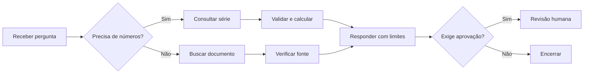

AULA 11 · MACROECONOMIA · 120 MINUTOS

# Agentes, ferramentas e fluxos de decisão

Quando vale permitir que um assistente escolha a próxima ferramenta, em vez de programar a sequência fixa?

O problemaUm analista solicita um resumo de indicadores simulados, comparação de períodos e comentário com fonte documental.

!!! abstract "Resultados de aprendizagem"
    - **1.** Workflows determinísticos e agentes.
    - **2.** Estado, ferramentas e nós.
    - **3.** Langgraph como orquestrador opcional.
    - **4.** Limites de iteração, erros e escalonamento humano.

<a href="aula.ipynb" download>↓ Notebook guiado</a><a href="slides/aula.html" target="_blank">▣ Slides</a><a href="opcionais/">+ Ampliação</a>

Conceitos · workflows determinísticos e agentes, estado, ferramentas e nós, LangGraph como orquestrador opcional, limites de iteração, erros e escalonamento humano

---

## 1. A escolha da próxima ação

Um fluxo fixo executa etapas predeterminadas. Um agente recebe um objetivo, observa o estado e escolhe uma ação dentre possibilidades permitidas. O termo *agente* não implica autonomia irrestrita. Em um sistema confiável, o espaço de ações, as entradas, as saídas e as condições de parada são deliberadamente limitados.

Um assistente macroeconômico pode dispor das ferramentas `consultar_serie`, `calcular_variacao` e `buscar_comunicado`. O modelo escolhe qual utilizar e com quais argumentos. Não deve alterar arquivos nem consultar informações externas sem autorização.

## 2. Estado e transições

Podemos representar o sistema por um estado com campos: `pergunta`, `serie`, `periodo`, `evidencias`, `resultado_calculo`, `erros` e `proxima_acao`. Uma transição válida modifica apenas os campos autorizados. **LangGraph** é um framework para representar nós e arestas de um grafo de execução; o conceito fundamental pode ser compreendido sem o framework.

## 3. Governança de ferramentas

Uma ferramenta pode lançar exceção, não encontrar dados ou devolver valores inesperados. O agente deve ter número máximo de etapas, timeout e registro de ações. Se a pergunta solicitar a Selic oficial e o corpus contém apenas simulação, a ação correta é declarar a ausência da informação, não extrapolar um número.

!!! example "Consulta permitida"
    *"Qual a variação do desemprego simulado entre dois meses disponíveis?"* exige localizar as observações, conferir as datas, calcular a diferença em pontos percentuais e citar a tabela. Uma pergunta sobre projeção oficial não pode ser respondida por esse mesmo conjunto de dados.

## 4. Quando não usar agente

Se uma aplicação recebe sempre um CSV e devolve três gráficos previamente definidos, o fluxo fixo costuma ser mais barato e fácil de testar. A liberdade de ação só se justifica quando a variabilidade das solicitações compensa o aumento de complexidade e risco.

## Laboratório interativo

Antes de realizar a atividade, **registre um palpite**. Depois altere os parâmetros, observe a resposta e explique a divergência. O simulador executa operações locais: não inventa acesso a dados nem faz chamadas a um LLM real.

<iframe src="../../assets/simuladores/laboratorio.html?modulo=11" title="Laboratório interativo da aula 11" loading="lazy"></iframe>

## Roteiro da aula (120 minutos)

| Tempo | Trabalho | Evidência observável |
|---|---|---|
| 00–10 min | Apresentar o caso e formular a pergunta | Critério de sucesso escrito |
| 10–35 min | Conceitos centrais com exemplos | Palpites e cálculos conferidos |
| 35–50 min | Exploração do simulador | Uma observação e sua explicação |
| 50–80 min | Notebook guiado: executar, modificar, comparar | Saída reproduzível |
| 80–105 min | Exercício individual de aplicação | Resultado + diagnóstico de um limite |
| 105–120 min | Debate dos erros e síntese | Registro do que foi ou não demonstrado |

## Atividade individual

1. Desenhar grafo de estados de uma consulta macroeconômica.
2. Executar um fluxo determinístico e comparar com seleção de ferramentas.
3. Introduzir erro de argumento e testar recuperação segura.

**Produto da aula:** Agente limitado que seleciona consultar_série, calcular e buscar_documento; registra cada passo.

## Exercício para a semana

Entregue no Blackboard, individualmente, **um registro conciso** (até duas páginas ou notebook com comentários) que documente: (a) a pergunta e o método; (b) os dados utilizados, seus períodos e unidades; (c) dois resultados reproduzíveis; (d) pelo menos uma limitação; (e) uma verificação independente de uma conclusão produzida com IA. O arquivo será mantido para documentação, **sem nota própria**. Os conceitos serão avaliados no quiz seguinte.

## Para conferir a compreensão

**Pergunta central:** Uma tarefa tem quatro etapas invariáveis. Qual vantagem oferece um workflow fixo frente a um agente autônomo?

Responda sem utilizar o simulador. A solução comentada será retomada no quiz correspondente. Não memorize comandos: explique o conceito e o motivo da escolha.

---

<a href="../10-melhorar-rag/">← Anterior</a><a href="../12-confiabilidade-e-seguranca/">Próximo →</a>

