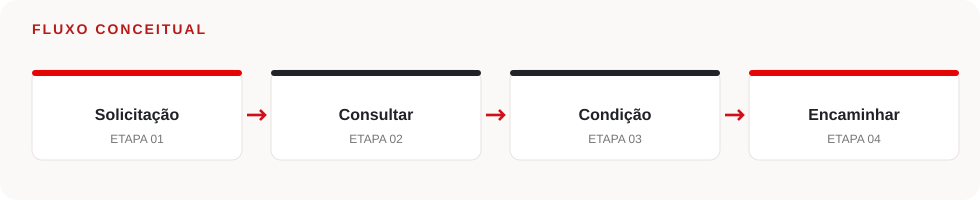

Aula 11 · Atendimento e operações

# Quem decide o próximo passo?

120 minutos60 min de conceitos60 min de aplicaçãoCodex · 100% por prompts

<strong>Pergunta da aula:</strong> Quando vale a pena permitir que um sistema escolha suas próprias ferramentas?

## Abertura · 10 minutos

A aula começa com a verificação da atividade entregue após a Aula 10. O aluno deve ter executado a aplicação em casa, registrado resultados e respondido às questões do handout. O quiz verifica a análise, não a escrita de código.

## 1. O problema de decisão

Um cliente recebeu um produto com defeito e solicita devolução. O atendimento precisa consultar o pedido, verificar a política, calcular o prazo e encaminhar o caso. Parte dessas decisões pode seguir regras fixas. Outra parte pode exigir seleção dinâmica de ferramentas. A aula contrapõe workflow explícito a agente, sem confundir autonomia com qualidade.

**Objetivo ao final do encontro:** saber explicar o mecanismo central, reconhecê-lo em exemplos pequenos e construir uma aplicação que permita observar seus limites.

## 2. Construção dos conceitos · 35 minutos

### 1. Workflow

Sequência de estados e transições previamente especificadas.

### 2. Agente

Sistema que observa resultados e escolhe ações dentro de limites autorizados.

### 3. Grafo e estado

Nós executam operações; arestas representam transições; o estado registra dados necessários à decisão.

### 4. Condição de parada

Evita ciclos ou ações adicionais quando o objetivo já foi alcançado ou uma revisão humana é necessária.

### Erros de interpretação frequentes

Não permitir que um agente atualize pedidos ou efetue pagamentos reais na aula; distinguir afirmação de ação verificável.

## 3. Exemplo mínimo · 15 minutos

**Situação.** Pedido entregue há cinco dias: consultar → verificar prazo → enviar para análise de elegibilidade. Pedido entregue há nove dias: consultar → verificar prazo → encaminhar para revisão humana. Sem número de pedido: solicitar complemento. Nenhum ramo executa reembolso automaticamente.

**Resolução e interpretação.** O caso de cinco dias apenas inicia análise de elegibilidade; a aprovação depende de outra ação. O grafo não deve equiparar elegibilidade a autorização.

**Para resolver em papel.** Desenhe um grafo para verificar um pedido e encaminhar para revisão humana conforme a política de sete dias.

A resolução deve explicitar as premissas antes de calcular ou interpretar um resultado. O objetivo não é reproduzir a interface da aplicação, mas compreender a estrutura lógica que ela implementa.

## 4. Simulador interativo

Use os controles para modificar uma hipótese e observar a consequência. O simulador é intencionalmente reduzido.

<iframe class="sim-frame" src="../../assets/simuladores/11.html" title="Grafo de estados e transições" loading="lazy"></iframe>

[Abrir o simulador em uma nova página](../../assets/simuladores/11.html) · [Apresentação da aula](slides/aula.html) · [Notebook da aula](aula.ipynb)

## 5. Laboratório com Codex · 50 minutos

**Aplicação:** Processador de solicitações com duas arquiteturas: workflow determinístico e agente com seleção de ferramentas.

A construção será feita inteiramente por prompts. O aluno pode inspecionar o código e pedir explicações, mas não editar linhas manualmente. O professor fornece uma versão de referência quando houver dependência de uma aula anterior.

### Prompt inicial para o Codex

> Transforme o atendimento em um processo executável com dados/orders.csv. Implemente ferramentas simuladas lookup_order, check_policy, request_approval e prepare_refund. Construa uma versão workflow e outra com escolha dinâmica de ferramentas, mas ambas sem autorização de executar pagamentos. Mostre estados, condições, argumentos, trilhas e número de chamadas. Compare casos de cinco, nove dias e falta de identificador.

### Três testes de aceitação

1. Pedido sem ID.
2. Prazo dentro da regra.
3. Agente com tentativa de chamada desnecessária.

## Duas rotas de execução

As duas alternativas são oferecidas no mesmo projeto. **Nenhuma exige escrever código manualmente.** A diferença está no modo de executar funcionalidades que dependem de um modelo.

=== "Rota A · API"

    1. Peça ao Codex para preparar a integração pelo SDK Python da OpenAI, com credencial em variável de ambiente e nunca no repositório.
    2. Solicite que ele execute testes com o conjunto local e, quando a API estiver autorizada, testes com modelo remoto.
    3. Compare as saídas e registre modelo, parâmetros, data e custos quando disponíveis.

=== "Rota B · Codex CLI / Python SDK"

    1. Autentique-se no Codex com a licença institucional disponível e abra a pasta do projeto.
    2. Solicite ao Codex, pela interface ou CLI, que execute a mesma tarefa em lotes sobre os arquivos locais, produzindo saídas estruturadas para conferência.
    3. Para automação supervisionada, o SDK Python `openai-codex` permite iniciar threads autenticadas no Codex e receber resultados. Essa alternativa **não equivale automaticamente a uma API de inferência em tempo real**. Use os resultados gerados em lote no laboratório local.

O laboratório inclui ainda uma demonstração determinística, que pode ser executada sem credenciais. [Detalhes técnicos e limites das rotas](../../programa/codex.md).

## 6. Verificação conceitual · 10 minutos

## 7. Atividade domiciliar

**Enunciado.** Utilize um segundo processo empresarial fictício, como troca de produto, cadastro ou agendamento, e compare workflow e agente em casos normais e excepcionais.

**Pergunta a responder.** Em que situação a autonomia do agente não traz vantagem?

**Entrega:** aplicação funcional, registro de pelo menos três testes (entrada, resultado, avaliação) e uma nota analítica de até uma página. Todo código será produzido pelo Codex.

[Handout da atividade](handout.md) · [Caderno de atividades](../../caderno/index.md)

## 8. Encadeamento

Na Aula 12, uma auditoria verificará se as trajetórias respeitam autorizações e limites.
