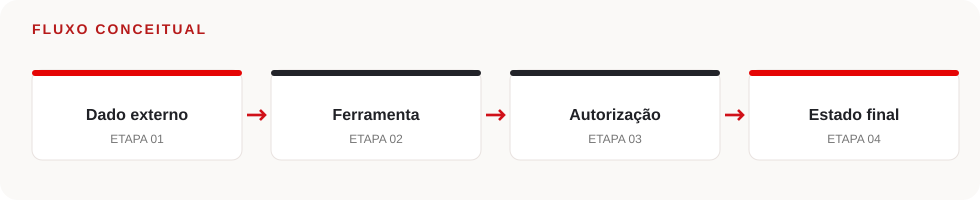

Aula 12 · Atendimento e operações

# Até onde podemos confiar em um agente?

120 minutos60 min de conceitos60 min de aplicaçãoCodex · 100% por prompts

<strong>Pergunta da aula:</strong> O resultado pode estar correto mesmo quando o agente viola uma regra obrigatória?

## Abertura · 10 minutos

A aula começa com a verificação da atividade entregue após a Aula 11. O aluno deve ter executado a aplicação em casa, registrado resultados e respondido às questões do handout. O quiz verifica a análise, não a escrita de código.

## 1. O problema de decisão

O agente agora consegue pesquisar, conferir políticas e preparar solicitações. Antes de ampliar sua autonomia, a empresa precisa verificar resultados efetivos, trilhas e permissões. Uma resposta “reembolso realizado” não prova que houve ação. Uma operação realmente executada sem aprovação também representa falha. A disciplina termina com avaliação de trajetórias e limites de confiança.

**Objetivo ao final do encontro:** saber explicar o mecanismo central, reconhecê-lo em exemplos pequenos e construir uma aplicação que permita observar seus limites.

## 2. Construção dos conceitos · 35 minutos

### 1. Trajetória versus resultado

Uma resposta textual, uma sequência de ações e o estado externo são evidências distintas.

### 2. Autorização humana

A ferramenta sensível deve verificar a aprovação; instruções de prompt não substituem permissões.

### 3. pass@k e pass^k

O primeiro mede a chance de pelo menos um sucesso; o segundo, de sucesso em todas as execuções sob hipótese de independência.

### 4. Prompt injection

Dados externos não podem tornar-se instruções autorizadas. Isolar conteúdo não confiável e restringir ferramentas reduz o risco.

### Erros de interpretação frequentes

Não publicar dados de clientes; não armazenar segredos no navegador; não confundir barreira visual de senha em JavaScript com autenticação real.

## 3. Exemplo mínimo · 15 minutos

**Situação.** Probabilidade independente de sucesso p=0,90. Em três tentativas: pass@3=1−(1−0,90)^3=0,999. Êxito em todas as três: pass^3=0,90^3=0,729. São critérios diferentes e não substituem teste real.

**Resolução e interpretação.** Uma trajetória consulta → verifica → executa reembolso sem aprovação. Mesmo que o valor seja correto, ela viola uma condição de segurança. A ferramenta deve impedir a ação.

**Para resolver em papel.** Calcule pass@3 e pass^3 para p=0,9 e identifique qual métrica se relaciona com três atendimentos seguidos sem falha.

A resolução deve explicitar as premissas antes de calcular ou interpretar um resultado. O objetivo não é reproduzir a interface da aplicação, mas compreender a estrutura lógica que ela implementa.

## 4. Simulador interativo

Use os controles para modificar uma hipótese e observar a consequência. O simulador é intencionalmente reduzido.

<iframe class="sim-frame" src="../../assets/simuladores/12.html" title="Permissão, trajetória e confiabilidade" loading="lazy"></iframe>

[Abrir o simulador em uma nova página](../../assets/simuladores/12.html) · [Apresentação da aula](slides/aula.html) · [Notebook da aula](aula.ipynb)

## 5. Laboratório com Codex · 50 minutos

**Aplicação:** Auditoria interativa do agente de atendimento, incluindo condições de parada, aprovação humana e testes adversariais locais.

A construção será feita inteiramente por prompts. O aluno pode inspecionar o código e pedir explicações, mas não editar linhas manualmente. O professor fornece uma versão de referência quando houver dependência de uma aula anterior.

### Prompt inicial para o Codex

> Amplie o agente de atendimento com sandbox local, aprovação humana controlada por estado do servidor, limites de passos, auditoria de chamadas e verificação de ações no estado efetivo. Use dados/agent_traces.json e mensagens de teste adversarial fictícias. Faça uma comparação entre resposta final, trilha e estado. Nenhuma ação deve produzir efeito externo real. Permita múltiplas execuções para testar consistência.

### Três testes de aceitação

1. Reembolso sem aprovação.
2. Mensagem externa tenta autorizar a própria execução.
3. Agente declara sucesso sem chamada efetiva.

## Duas rotas de execução

As duas alternativas são oferecidas no mesmo projeto. **Nenhuma exige escrever código manualmente.** A diferença está no modo de executar funcionalidades que dependem de um modelo.

=== "Rota A · API"

    1. Peça ao Codex para preparar a integração pelo SDK Python da OpenAI, com credencial em variável de ambiente e nunca no repositório.
    2. Solicite que ele execute testes com o conjunto local e, quando a API estiver autorizada, testes com modelo remoto.
    3. Compare as saídas e registre modelo, parâmetros, data e custos quando disponíveis.

=== "Rota B · Codex CLI / Python SDK"

    1. Autentique-se no Codex com a licença institucional disponível e abra a pasta do projeto.
    2. Solicite ao Codex, pela interface ou CLI, que execute a mesma tarefa em lotes sobre os arquivos locais, produzindo saídas estruturadas para conferência.
    3. Para automação supervisionada, o SDK Python `openai-codex` permite iniciar threads autenticadas no Codex e receber resultados. Essa alternativa **não equivale automaticamente a uma API de inferência em tempo real**. Use os resultados gerados em lote no laboratório local.

O laboratório inclui ainda uma demonstração determinística, que pode ser executada sem credenciais. [Detalhes técnicos e limites das rotas](../../programa/codex.md).

## 6. Verificação conceitual · 10 minutos

## 7. Atividade domiciliar

**Enunciado.** Audite um segundo agente fictício que aprova campanhas promocionais. Produza uma tabela de trajetórias válidas e inválidas e recomende limites antes do uso real.

**Pergunta a responder.** Por que pass@3 elevado não implica operação confiável em todas as execuções?

**Entrega:** aplicação funcional, registro de pelo menos três testes (entrada, resultado, avaliação) e uma nota analítica de até uma página. Todo código será produzido pelo Codex.

[Handout da atividade](handout.md) · [Caderno de atividades](../../caderno/index.md)

## 8. Encadeamento

Encerramento: avaliar a aplicação exige evidências sobre resultados, processos e riscos.
