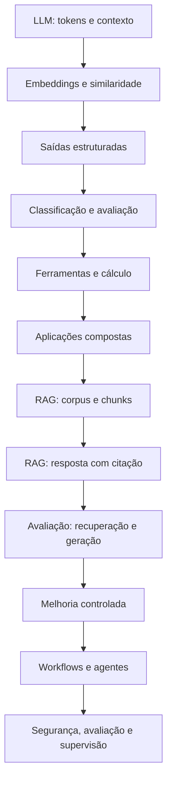

# Mapa conceitual

O curso percorre quatro estágios. Em cada estágio, a pergunta muda: **o que o sistema sabe?** → **o que ele consegue extrair?** → **onde está a evidência?** → **quais ações são permitidas?**

| Camada | Pergunta para decidir | Erro típico |
|---|---|---|
| LLM | Há dados suficientes? | Confundir plausibilidade com estimativa |
| Embedding | Qual noção de similaridade é útil? | Confundir proximidade textual com substituição econômica |
| Saída estruturada | O campo existe e está correto? | Confundir JSON válido com fato |
| Ferramentas | O cálculo usa argumentos confiáveis? | Dividir por zero; misturar unidades |
| RAG | A fonte certa foi recuperada? | Citar trimestre errado |
| Avaliação | A evidência sustenta o texto? | Premiar resposta sem apoio documental |
| Agentes | A ação é autorizada? | Obedecer instrução inserida em fonte |
